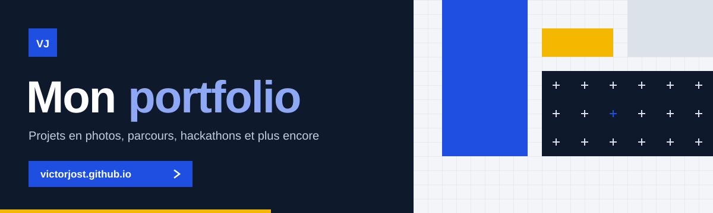

 

  
  
  

## À propos

Tout a commencé très jeune, manette en main. À force de jouer, je me suis demandé ce qui se passait derrière l'écran : comment fonctionne un ordinateur, comment un programme prend vie.

Aujourd'hui je suis en **3e année à EPITECH Nancy**, avec un profil de développeur généraliste : du C# et .NET en entreprise, du Python sur une voiture autonome, du TypeScript pour le web, et **Imperium**, une suite de systèmes de jeu que je porte sur une douzaine de moteurs et de langages.

À côté, je m'occupe d'**EpiClutch**, l'association jeu vidéo de l'école, je suis **ambassadeur EPITECH** et j'encadre des collégiens et lycéens aux **Coding Clubs**.

## Projets

| Projet | Ce que c'est | Stack |
|---|---|---|
| **[Imperium](https://github.com/imperium-systems)** | Les mêmes systèmes de jeu, avec la même API, sur Roblox, Unity, Unreal, Godot, le web et des moteurs maison | 12 implémentations, 9 langages |
| **Robocar** | Voiture RC autonome qui suit deux lignes blanches : IA, Jetson Nano, câblage, impression 3D | Python |
| **House Scoreboard** | Saisie des temps de natation et calcul automatique des points d'un barème maison | TypeScript, Node.js, Vite |
| **Sensai** | Chatbot qui tourne en local avec Ollama | Python |
| **[CampusMatch](https://github.com/VictorTV57/campus-match)** | Choisir son université de 4e année en swipant, avec un score de compatibilité | TypeScript |
| **[GPATek](https://github.com/VictorTV57/GPATek)** | Extension web qui calcule le GPA en temps réel | JavaScript |
| **Zappy** | Monde virtuel en réseau : serveur, IA autonomes et client graphique | C, C++ |
| **Raytracer** | Moteur de rendu 3D par lancer de rayons | C++ |

<b>Imperium : un même appel, partout</b>

 

Régler l'heure à 18 h avec le module **Hora** (dans **Mundus**) :

| Moteur | Langage | Appel |
|---|---|---|
| Roblox | Luau | `Hora.SetTime(18)` |
| Unity | C# | `Hora.SetTime(18)` |
| Unreal Engine | C++ | `UHora::SetTime(18)` |
| Godot | GDScript | `Hora.set_time(18)` |
| Godot | C# | `Hora.SetTime(18)` |
| Moteur maison | C++ | `hora::set_time(18)` |
| Moteur maison | C# | `Hora.SetTime(18)` |
| Moteur maison | C | `imperium_hora_set_time(18)` |
| Moteur maison | Java | `Hora.setTime(18)` |
| Moteur maison | Python | `hora.set_time(18)` |
| Moteur maison | Rust | `hora::set_time(18)` |
| Web | TypeScript | `Hora.setTime(18)` |

## Portfolio

Mes projets, mon parcours et mes compétences sont détaillés sur mon site.

## Compétences

**Langages**

  
  
  
  
  
  

**Notions**

  
  
  

**Frameworks et outils**

  
  
  
  
  
  

**Langues** : français (langue maternelle), anglais (825 au TEPitech, équivalent TOEIC)

## Parcours

| Quand | Quoi |
|---|---|
| 2024 – 2029 | **Programme Grande École**, EPITECH Nancy (3e année) |
| En cours | **EpiClutch**, responsable de l'association jeu vidéo de l'école |
| En cours | **Ambassadeur EPITECH**, salons et journées portes ouvertes |
| En cours | **Manta**, encadrement de collégiens et lycéens aux Coding Clubs |
| Sept. – déc. 2025 | **Développeur stagiaire**, ONYX Informatique (C#, .NET MAUI, SQL Server) |
| 2025 et 2026 | **Capitaine d'équipe bénévole**, VivaTech Paris |

**Hackathons** : Nancy Justice Tech 2025 et 2026, Game Jam EPITECH, Hack'In Thionville

Hors du clavier : randonnée avec les Scouts Unitaires de France, vélo, et la course du mardi soir au BlaBlaRunClub à Nancy.

